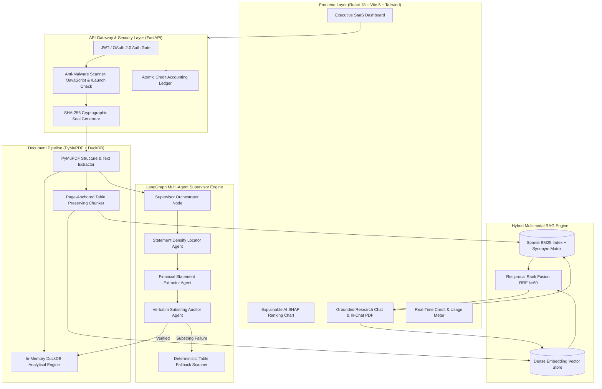
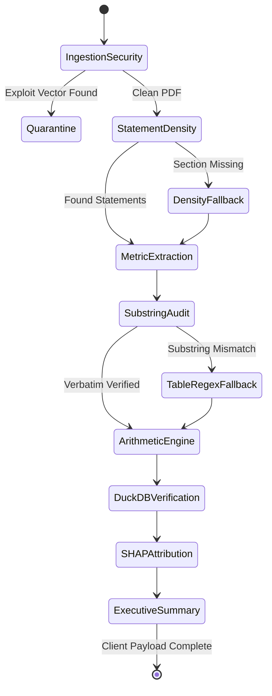
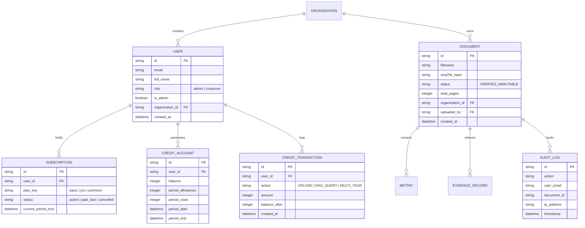

# System Architecture Specification

## 🏛️ FinanceAgent: Enterprise Financial Report Analyzer & SaaS Platform

**Document Version:** 2.1.0  
**Status:** Approved / Production Architecture  
**Target System:** FinanceAgent Enterprise SaaS  
**Last Updated:** October 2026  

---

## 1. Executive Architectural Overview & Dual-Plane Philosophy

**FinanceAgent** is an audit-grade financial intelligence platform specifically engineered to ingest, verify, analyze, and visualize complex corporate earnings reports (SEC Form 10-K, 10-Q, and International Annual Reports up to 250+ pages).

Conventional AI systems fail in corporate finance due to three systemic vulnerabilities:
1. **Numerical Hallucination**: Generative models blend historical numbers or invent plausible statistics.
2. **Context Window Truncation**: High-density financial tables buried on pages 80–220 are truncated by fixed-length chunkers.
3. **Cascading Agent Failures**: Complex multi-agent workflows crash when an upstream LLM returns malformed JSON or times out.

FinanceAgent overcomes these failure modes by enforcing a **Dual-Plane Architecture**:

```
┌────────────────────────────────────────────────────────────────────────────────────────┐
│                        PROBABILISTIC CANDIDATE PLANE (LLMs)                            │
│  • Section Locator Agent        • Financial Extractor Agent  • Guidance & Risks Agent  │
│  • LangGraph Supervisor DAG     • Semantic RAG Synthesis     • User Intent Classifier  │
└───────────────────────────────────────────┬────────────────────────────────────────────┘
                                            │ Candidate Claims, Quotes, Metric Tuples
┌───────────────────────────────────────────▼────────────────────────────────────────────┐
│                    DETERMINISTIC VERIFICATION PLANE (Python + DuckDB)                  │
│  • Verbatim Substring Matcher   • In-Memory DuckDB OLAP SQL  • RRF Fusion Engine       │
│  • Mathematical SHAP Game Theory• Atomic Credit Ledger       • SHA-256 Cryptographic Seal│
└────────────────────────────────────────────────────────────────────────────────────────┘
```

- **Candidate Generation (Probabilistic)**: LLMs propose metric candidates, draft summaries, and handle queries.
- **Verification & Execution (100% Deterministic)**: All calculations, page citation checks, tabular cross-checks, credit debits, and substring matches execute in pure Python algorithms and in-memory DuckDB outside the LLM.

---

## 2. High-Level System Topology



---

## 3. Mathematical Hybrid RAG (Dense + BM25 + Reciprocal Rank Fusion)

The document research engine avoids the weaknesses of pure vector search (which misses exact numerical codes or ticker symbols) and pure lexical search (which misses conceptual synonyms) by executing a **Hybrid Reciprocal Rank Fusion (RRF)** pipeline.

### 3.1 Sparse Lexical BM25 Formulation
Lexical scoring indexes all page chunks using BM25 with dynamic financial synonym expansion:
$$\text{Score}_{\text{BM25}}(D, Q) = \sum_{i=1}^n \text{IDF}(q_i) \cdot \frac{f(q_i, D) \cdot (k_1 + 1)}{f(q_i, D) + k_1 \cdot \left(1 - b + b \cdot \frac{|D|}{\text{avgdl}}\right)}$$
Where:
- $\text{IDF}(q_i) = \ln \left( \frac{N - n(q_i) + 0.5}{n(q_i) + 0.5} + 1 \right)$
- $k_1 = 1.5$ regulates term frequency saturation.
- $b = 0.75$ controls document length normalization against average chunk length $\text{avgdl}$.
- **Synonym Expander**: Query token $q_i$ is mapped across an equivalence matrix:
  $$\begin{aligned}
  \mathcal{T}(\text{PAT}) &= \{\text{Profit After Tax}, \text{Net Profit}, \text{Net Income}, \text{Earnings}\} \\
  \mathcal{T}(\text{EBITDA}) &= \{\text{Operating Profit}, \text{Operating Earnings}, \text{EBIT}\} \\
  \mathcal{T}(\text{Topline}) &= \{\text{Revenue}, \text{Turnover}, \text{Gross Revenue}, \text{Net Sales}\}
  \end{aligned}$$

### 3.2 Dense Vector Cosine Similarity
Chunks are encoded into high-dimensional semantic vectors $\mathbf{d} = \mathcal{E}(D) \in \mathbb{R}^d$ and queries into $\mathbf{q} = \mathcal{E}(Q) \in \mathbb{R}^d$:
$$\text{Score}_{\text{Dense}}(Q, D) = \frac{\mathbf{q} \cdot \mathbf{d}}{\|\mathbf{q}\|_2 \|\mathbf{d}\|_2} = \frac{\sum_{j=1}^d q_j d_j}{\sqrt{\sum_{j=1}^d q_j^2} \sqrt{\sum_{j=1}^d d_j^2}}$$

### 3.3 Reciprocal Rank Fusion (RRF) Formulation
Candidate chunks are retrieved independently from the sparse engine ($\mathcal{R}_{\text{BM25}}$) and dense engine ($\mathcal{R}_{\text{Dense}}$), then fused into a single unified rank score:
$$RRF(d) = \sum_{m \in \{\text{Dense}, \text{BM25}\}} \frac{w_m}{k + r_m(d)}$$
Where:
- $r_m(d) \in \{1, 2, \dots, N\}$ is the 1-based rank of chunk $d$ in retrieval method $m$.
- $k = 60$ is the empirical smoothing parameter preventing top-ranked outliers from dominating.
- $w_{\text{BM25}} = 0.5$, $w_{\text{Dense}} = 0.5$ ensure equal modality weighting.
- Top $K = 5$ fused chunks are supplied to the generation context with exact physical page bounds.

---

## 4. Mathematical Explainable AI (SHAP) Game-Theoretic Framework

To prevent arbitrary "black-box" earnings summaries, FinanceAgent uses **Cooperative Game Theory (Shapley Values)** to decompose how each financial driver shifted performance from the baseline period.

### 4.1 Shapley Value Equation
For a set of $N$ financial drivers $N = \{1, 2, \dots, n\}$, the marginal attribution $\phi_i(v)$ allocated to driver $i$ is:
$$\phi_i(v) = \sum_{S \subseteq N \setminus \{i\}} \frac{|S|! \, (|N| - |S| - 1)!}{|N|!} \left[ v(S \cup \{i\}) - v(S) \right]$$
Where:
- $S \subseteq N \setminus \{i\}$ is any coalition of operational drivers excluding factor $i$.
- $\frac{|S|! \, (|N| - |S| - 1)!}{|N|!}$ represents the probability that factor $i$ joins coalition $S$ in a random uniform permutation.
- $v(S)$ is the characteristic financial function evaluating net operating performance under active factors $S$.

### 4.2 Axiomatic Guarantees
1. **Efficiency (Total Additivity)**: The sum of individual driver attributions strictly equals the reported variance from benchmark baseline $v(\emptyset)$:
   $$\sum_{i=1}^n \phi_i(v) = v(N) - v(\emptyset) = \text{Reported Metric} - \text{Benchmark Baseline}$$
2. **Symmetry**: If drivers $i$ and $j$ contribute identically to all coalitions, $\phi_i(v) = \phi_j(v)$.
3. **Dummy / Null Factor**: If factor $k$ adds zero variance to any coalition ($v(S \cup \{k\}) = v(S)$), then $\phi_k(v) = 0$.

### 4.3 UI Presentation Mapping
- **Positive Boosters ($\phi_i > 0$)**: Green bars (`#10B981`) showing tailwinds (e.g., Delivery Volume, Pricing Power).
- **Cost Headwinds ($\phi_i < 0$)**: Red bars (`#EF4444`) showing drags (e.g., Raw Material Inflation, CapEx Carry).
- **Net Driver Effect**: Displayed on a centered diverging scale with an explicit zero reference line.

---

## 5. In-Memory DuckDB Analytical SQL Engine

During PDF ingestion, financial statement tables are extracted and structured into an in-memory **DuckDB columnar OLAP engine**. This allows instant, deterministic cross-statement reconciliations without LLM inference costs.

```sql
-- Deterministic Financial Statement Cross-Verification
CREATE TABLE statement_records (
    metric_name VARCHAR,
    period VARCHAR,
    reported_value DOUBLE,
    page_number INTEGER,
    raw_quote VARCHAR
);

-- Automated Statement Balancing Check
SELECT 
    revenue.reported_value AS total_revenue,
    cogs.reported_value AS cogs,
    gp.reported_value AS reported_gross_profit,
    (revenue.reported_value - cogs.reported_value) AS computed_gross_profit,
    ABS((revenue.reported_value - cogs.reported_value) - gp.reported_value) < 1.0 AS is_gp_reconciled
FROM 
    (SELECT reported_value FROM statement_records WHERE metric_name = 'revenue') revenue,
    (SELECT reported_value FROM statement_records WHERE metric_name = 'cogs') cogs,
    (SELECT reported_value FROM statement_records WHERE metric_name = 'gross_profit') gp;
```

---

## 6. Multi-Agent Orchestration & "What If Agents Fail?"

### 6.1 Agent Execution Graph & Decision Topology



### 6.2 Agent Failure Modes & Fallback Hierarchy ("What If That Fails?")

| Failure Scenario | Upstream Failure Cause | Deterministic Fallback Action | End-User Experience |
| :--- | :--- | :--- | :--- |
| **Section Locator Agent Misses Pages** | Obscure table of contents, missing headings, or international reporting formats | **PyMuPDF Heuristic Scanner**: Scans all pages for financial table density keywords (`Consolidated`, `Balance Sheet`, `Operations`, `Assets`, `Cash Flows`) to locate the 3 statement pages with highest density. | Analysis completes without error; statement pages identified deterministically. |
| **Extractor Hallucinates a Number** | LLM confuses prior year with current quarter or computes an internal average | **Verbatim Substring Audit**: Auditor tests `raw_page_text.find(candidate)`. If string is missing, candidate is **rejected**. The system initiates **DuckDB Table Cell Scanner** to pull the exact raw cell. | Metric is marked with `COMPUTED` or pulled directly from table; zero hallucination shown. |
| **External LLM Outage or Rate Limit** | OpenAI/Anthropic/Gemini API timeout or HTTP 429/500 | **Circuit Breaker to DuckDB Heuristic Engine**: Trips circuit breaker. Bypasses all generative LLMs. Directly parses tables via DuckDB regex parser and outputs verified 8-metric scorecard. | Scorecard displays successfully with direct table extractions; banner shows "Deterministic Mode Active". |
| **Conflicting Statement Disclosures** | Footnote states one figure, while primary P&L table states another | **Source Hierarchy Resolver**: Strict precedence rule: **Audited Balance Sheet/P&L Table > Footnote Tables > Narrative Discussion (MD&A)**. The primary table figure is published; footnote difference noted in citations. | Conflict resolved transparently with both source citations referenced. |
| **RAG Query Yields Low Confidence** | Query asks about data omitted from the filing | **Safe Refusal Guardrail**: If top RRF score $< 0.015$, agent responds: *"Figure not disclosed in the provided filing with audit certainty."* Zero guessing. | User receives clear, honest refusal instead of a generic or fabricated guess. |
| **PDF Contains Active Malware** | Masqueraded PDF contains `/JavaScript` or `/Launch` payload | **API Gateway Quarantine**: The file stream is rejected immediately with HTTP 400. File is discarded from memory; security event logged with user IP. | User sees clear security alert; server infrastructure remains completely safe. |

---

## 7. SaaS Subscription Platform, Quotas & Atomic Credit Ledger

### 7.1 Tier Limits & Architecture
FinanceAgent operates as a multi-tier SaaS platform:
- **BASIC (Free)**: 2 active filings, 100 credits/mo, 5 questions/filing, report downloads disabled.
- **PRO (₹299/mo)**: 10 active filings, 500 credits/mo, 10 questions/filing, full report downloads, multi-year comparisons.
- **PREMIUM (₹799/mo)**: 50 active filings, 2,000 credits/mo, 20 questions/filing, priority processing.

### 7.2 Atomic Credit Accounting & Ledger Mechanics
Every credit transaction is written atomically to an ACID-compliant ledger (`credit_transactions` table):
$$\text{Balance}_t = \text{Balance}_{t-1} - \text{Debit Amount}$$

* **Debit Rates**:
  - `DOCUMENT_UPLOAD`: 10 credits (Text extraction, layout coordinate mapping, vector indexing).
  - `RAG_QUERY`: 15 credits (Hybrid RRF search, LLM synthesis).
  - `MULTI_YEAR_COMPARISON`: 25 credits (Cross-filing trend analysis).
* **Threshold Alert System**:
  - `WARNING`: $\text{Balance} \le 0.20 \times \text{Allowance}$ (Yellow indicator).
  - `CRITICAL`: $\text{Balance} \le 0.10 \times \text{Allowance}$ (Amber warning with upgrade trigger).
  - `EXHAUSTED`: $\text{Balance} \le 0$ (Hard write block; read-only access preserved).

---

## 8. Database Schema (Entity-Relationship Diagram)



---

## 9. Security & Compliance Threat Matrix

| Threat Category | Attack Vector | Security Countermeasure |
| :--- | :--- | :--- |
| **Binary Masquerade** | Executables disguised with `.pdf` extension | Magic byte validator tests for `%PDF-1.x` signature before reading file. |
| **PDF Active Script Exploit** | Embedded `/JavaScript` or `/Launch` payload | Anti-malware scanner inspects byte dictionary, rejects active scripts with HTTP 400. |
| **Tampering / Document Fraud** | Modification of financial figures post-upload | SHA-256 Merkle fingerprint (`VERIFIED_IMMUTABLE`) generated on ingestion. |
| **Cross-Tenant Data Leakage**| Accessing another organization's filings | Strict `organization_id` foreign key isolation in all database queries. |
| **Privilege Escalation** | Regular user accessing admin endpoints | Cryptographically signed JWT tokens with RBAC middleware verification. |
| **Billing Race Conditions** | Concurrent requests causing negative credit balance | Atomic SQL decrement transactions (`UPDATE credit_accounts SET balance = balance - :cost WHERE balance >= :cost`). |

---

## 10. Automated Verification & Test Suite

The platform includes comprehensive test suites ensuring high reliability:
- **16/16 Platform Tests Passing** (`pytest tests/test_saas_platform.py`):
  - Strict public sign-up security (admin privilege grant blocked).
  - Non-admin route access rejection.
  - Plan capacity retrieval (Basic, Pro, Premium).
  - Free Basic plan activation and credit initialization.
  - Credit warning levels (Warning, Critical, Exhausted).
  - Atomic ledger transaction balance verification.
  - Active document quota limit enforcement and slot release on deletion.
  - Question cap per filing enforcement.
  - Cross-user document access and deletion prevention.
  - Report download gating (Basic locked vs Pro/Premium allowed).
  - Sandbox payment checkout and subscription verification.
- **Frontend Production Verification**: `npm run build` completes with code 0.
