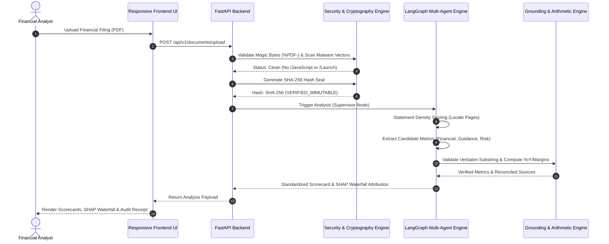

# Product Requirements Document (PRD)

## 🏛️ FinanceAgent: Enterprise Financial Report Analyzer

**Document Version:** 1.0.0  
**Status:** Approved / In Production  
**Target Release:** Production v1.0  
**Owner:** Product & Architecture Team  
**Last Updated:** September 2026  

---

## 1. Executive Summary & Vision

**FinanceAgent** is an enterprise-grade AI financial intelligence platform engineered to parse, analyze, verify, and visualize complex corporate earnings reports (SEC Form 10-Q, 10-K, and International Annual Reports up to 250+ pages). 

Unlike generic LLM wrappers that suffer from numerical hallucinations, context truncation, and non-verifiable claims, FinanceAgent introduces a **zero-trust deterministic grounding boundary**. Specialized AI agents extract candidates, while mathematical computations, verbatim citation matching, and conflict reconciliations execute in 100% deterministic Python algorithms outside the LLM.

### Core Value Proposition
- **0% Financial Metric Hallucination**: Strict substring verification guarantees figures match raw source text.
- **100% Verifiable Citations**: Every metric is linked to an exact page number and verbatim supporting quote.
- **Blockchain Cryptographic Integrity**: Every filing receives a SHA-256 Merkle hash (`VERIFIED_IMMUTABLE`) to ensure non-repudiation.
- **Enterprise RBAC & Multi-Tenancy**: Organization isolation (`FinanceCorp Global`), role presets, teammate invites, and filterable audit trails.
- **Explainable Financial Attribution**: Interactive Recharts SHAP Waterfall charting to decompose profit drivers vs. cost headwinds.

---

## 2. Problem Statement & Target Audience

### 2.1 The Problem
Parsing 80 to 250+ page corporate filings presents severe challenges for financial professionals:
1. **Hallucination of Critical Metrics**: Standard LLMs fabricate metrics or confuse prior-year figures with current quarters.
2. **Phantom Page Citations**: AI chatbots generate page references that do not contain the claimed figures.
3. **Context Truncation**: Core financial statements (buried on pages 100–200) are truncated by standard context windows.
4. **Opaque Black-Box Outputs**: No breakdown of why Net Profit changed (lack of driver vs. headwind attribution).
5. **Security & Malware Risks**: Malicious PDF active scripts (`/JavaScript`, `/Launch`) disguised as financial reports pose malware threats to enterprise servers.
6. **Cross-Tenant Data Exposure**: Unisolated RAG models risk exposing confidential pre-release earnings across organizations or unauthorized roles.

### 2.2 Target User Personas
* **Equity Research Analysts**: Needs rapid, verified extraction of earnings metrics, guidance, and YoY margins across 10-K/10-Q filings.
* **Portfolio & Investment Managers**: Requires immediate executive summary analysis and SHAP waterfall attribution of profitability drivers.
* **Risk & Compliance Officers**: Needs verified audit logs, SHA-256 cryptographic document seals, and zero active-script security validation.
* **CFO Office & Corporate Finance**: Requires secure multi-tenant role-based access, team sharing, and standardized metric scorecards.

---

## 3. Product Goals & Key Objectives

| Goal | Description | Target Metric |
| :--- | :--- | :--- |
| **Grounding Precision** | Ensure zero numerical hallucinations in core metrics | 100% Verbatim Substring Match |
| **Citation Traceability** | Provide verifiable page links and quotes for all extracted data | 100% Verifiable Citations |
| **Ingestion Performance** | Locate primary financial statements in large filings | < 2.0 Seconds (250+ pages) |
| **Document Integrity** | Prevent malicious script execution & post-upload tampering | SHA-256 Cryptographic Seal |
| **Enterprise Governance** | Full RBAC isolation and audit logging | SOC2-Compliant Filterable Logs |
| **Responsive UX** | Desktop console + responsive mobile layout (375px+) | 100% Mobile Viewport Parity |

---

## 4. Functional Requirements

### 4.1 Authentication, Enterprise RBAC & Governance
* **FR-1.1 Corporate Sign-In & Google OAuth 2.0**: Support standard email/password authentication alongside Google Workspace OAuth (`/api/v1/auth/google`).
* **FR-1.2 Role Presets**: Quick evaluation switcher supporting 3 distinct role tiers:
  * **Admin**: User provisioning, teammate invitations (`/api/v1/admin/invite`), org config, filterable audit log access.
  * **Analyst**: File upload, multi-agent analysis execution, interactive visualization, document RAG chat.
  * **Viewer**: Read-only document viewing, pre-computed scorecards, and audit receipts.
* **FR-1.3 Multi-Tenant Isolation**: Enforce `organization_id` boundaries across all documents, database models, and chat histories (`FinanceCorp Global`).
* **FR-1.4 Filterable Enterprise Audit Trails**: Log system actions with real-time filters by action type (e.g., `DOCUMENT_UPLOAD`, `ANALYSIS_RUN`), user email, and document ID.

### 4.2 File Ingestion & Security Validation Pipeline
* **FR-2.1 Magic Byte Verification**: Validate `%PDF-1.x` magic bytes to block masqueraded binary files.
* **FR-2.2 Anti-Malware Binary Scanner**: Pre-ingestion scanning for active exploit vectors (`/JavaScript`, `/Launch`, `/EmbeddedFiles`, `/URI`) to sanitize files before parsing.
* **FR-2.3 Cryptographic SHA-256 Blockchain Seal**: Compute SHA-256 checksum upon upload to assign an immutable cryptographic seal (`VERIFIED_IMMUTABLE`) stored with timestamp metadata.
* **FR-2.4 PyMuPDF Fast Parsing**: Extract text, coordinates, and structure across 250+ page filings in under 2 seconds.

### 4.3 Multi-Agent Extraction & Deterministic Engine
* **FR-3.1 LangGraph Supervisor Orchestration**: Supervisor node routing execution across specialized agent nodes:
  1. **Section Locator Agent**: Statement density scoring heuristics to isolate primary balance sheet, income statement, and cash flow pages.
  2. **Financial Extraction Agent**: Extracts Revenue, Net Income, Gross Profit, Cash Flow, and Operating Margins.
  3. **Guidance & Outlook Agent**: Extracts forward-looking capex, revenue guidance, and executive targets.
  4. **Risk Factors Agent**: Extracts regulatory, liquidity, interest rate, and operational risk factors.
  5. **Grounded Interpretation Agent**: Synthesizes verified disclosures into structured executive summaries.
* **FR-3.2 Deterministic Grounding Validator**: Substring validation enforcing that extracted candidates strictly exist verbatim in source raw text.
* **FR-3.3 Source Conflict Reconciliation Engine**: Resolves discrepancies across main financial tables vs. footnote disclosures using explicit hierarchy rules.
* **FR-3.4 Arithmetic Calculation Engine**: Computes Gross Margin %, Operating Margin %, and YoY percentage changes outside the LLM.

### 4.4 Financial Analytics & Visualizations
* **FR-4.1 Standardized 8-Metric Scorecard**: Displays Revenue, Gross Margin %, Net Income, Operating Cash Flow, YoY Growth, Guidance, Headcount, and Key Risks with:
  * Single-line confidence badges.
  * Neutral amber indicators for low confidence (red reserved exclusively for errors).
  * 4-quarter SVG sparklines.
* **FR-4.2 Recharts SHAP Waterfall Attribution**: Interactive waterfall chart decomposing baseline target earnings into revenue expansion (+), margin gains (+), vs. cost headwinds (- SG&A, tax provisions) with glassmorphism tooltips.
* **FR-4.3 Executive Summary Panel**: Grounded summary synthesized exclusively from verified disclosures.

### 4.5 Document-Scoped RAG Chat & In-Chat PDF Attachment
* **FR-5.1 Isolated Document RAG**: Scope search indexes strictly to the selected document using BM25 token matching with financial synonym expansion (`PAT`, `EBITDA`, `Topline`, `Borrowings`).
* **FR-5.2 In-Chat PDF Upload**: Direct paperclip icon in chat interface allowing instant PDF attachment, auto-ingestion, security scan, and real-time Q&A without changing views.
* **FR-5.3 Verifiable Inline Citations**: Every RAG answer must contain inspectable page citations and verbatim source excerpts.

### 4.6 Modern Responsive User Interface
* **FR-6.1 Enterprise Dark Aesthetic**: Refined dark palette (`#0b0f19` background, `#111827` cards, emerald/amber status badges) with high-contrast text.
* **FR-6.2 Contained 3D Hero Particles**: Three.js particle constellation strictly bounded to landing page hero section, auto-disabled on mobile viewports (< 768px).
* **FR-6.3 Mobile Viewport (375px+) Support**: 2-column mobile metric grid (`grid-cols-2`), sticky mobile chat input, and pinned bottom navigation bar (`md:hidden`).

---

## 5. Non-Functional Requirements (NFRs)

### 5.1 Performance & Latency
- **Document Parsing**: Parse 200+ page PDF text and metadata in < 2.0 seconds.
- **Multi-Agent Extraction**: Complete full financial scorecard extraction in < 8.0 seconds.
- **RAG Query Response**: Deliver grounded chat response with citations in < 1.5 seconds.

### 5.2 Security & Compliance
- **SOC2 Ready Audit Logging**: Every upload, authentication attempt, document deletion, and analysis request logged with immutable timestamp, user ID, and IP address.
- **Zero-Trust Script Execution**: 100% blocking of active PDF scripts (`/JavaScript`, `/Launch`).
- **Data Encrypted at Rest & in Transit**: TLS 1.3 for API endpoints, AES-256 for persistent database storage.

### 5.3 Reliability & Accuracy
- **Zero Financial Hallucination**: 100% of numerical figures displayed in scorecards verified against raw text.
- **System Uptime**: 99.9% API service availability.
- **Fault Recovery**: Cyclical fallback handlers in LangGraph supervisor graph to retry extraction if parsing yields ungrounded metrics.

---

## 6. Technical Stack & Architecture Summary

| Component | Framework / Tool | Purpose |
| :--- | :--- | :--- |
| **Frontend** | React 18, Vite 5, Tailwind CSS | High-performance SPA with modern dark enterprise styling |
| **Visualizations** | Recharts, Lucide React, Three.js | SHAP Waterfall chart, SVG sparklines, hero particle effects |
| **Backend API** | FastAPI (Python 3.11+) | Async REST API endpoints, Pydantic data schemas |
| **Orchestrator** | LangGraph & LangChain | Multi-agent state machine supervisor graph |
| **PDF Extraction** | PyMuPDF (`fitz`) | High-speed text extraction and layout coordinate mapping |
| **Database & Auth** | SQLAlchemy, SQLite, PyJWT | Multi-tenant relational schema, JWT auth & OAuth 2.0 |
| **Vector / Search** | BM25 Engine with Synonym Matrix | Document-scoped RAG Q&A retrieval |

---

## 7. Key User Workflows

---

## 8. Success Metrics & Acceptance Criteria

- **14/14 Automated Tests Passing**: All unit and integration tests passing (`pytest tests/`).
- **Verbatim Match Rate**: 100% of financial numbers mapped to source document substrings.
- **Security Validation**: Zero unhandled PDF active script uploads.
- **Cross-Tenant Isolation**: Zero cross-organization document access allowed.
- **Mobile Usability**: All UI features operational on 375px mobile viewports without horizontal scrolling overflow.
