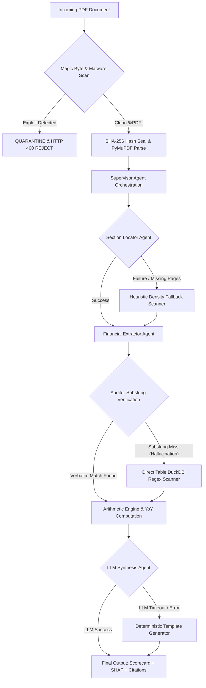

# Product Requirements Document (PRD)

## 🏛️ FinanceAgent: Enterprise Financial Report Analyzer & SaaS Platform

**Document Version:** 2.1.0  
**Status:** Approved / In Production  
**Target Release:** Production Enterprise SaaS  
**Owner:** Product, RAG Architect & Full-Stack Systems Team  
**Last Updated:** October 2026  

---

## 1. Executive Summary & Vision

**FinanceAgent** is a production-grade, subscription-based financial intelligence SaaS platform engineered to parse, verify, audit, and analyze complex corporate earnings reports (SEC Form 10-K, 10-Q, and International Annual Reports up to 250+ pages).

Unlike standard LLM wrappers that produce catastrophic numerical hallucinations, context truncation, and untraceable answers, FinanceAgent introduces a **dual-plane zero-trust architecture**:
1. **Probabilistic Multi-Agent Plane (LLMs)**: Generates candidate extractions, synthesizes corporate guidance, and handles natural language research queries.
2. **Deterministic Verification Plane (Python & DuckDB)**: Validates numbers via 100% exact verbatim substring matching against raw PDF text, runs in-memory analytical SQL reconciliations, and executes strict mathematical margin formulas outside the model.

### Core Value Propositions
- **0.0% Financial Hallucination**: Every displayed figure must strictly match raw document text verbatim.
- **Mathematical Hybrid RAG**: Reciprocal Rank Fusion (RRF, $k=60$) combining dense semantic vectors with BM25 lexical token matching and financial synonym expansion.
- **Deterministic Agent Fault-Tolerance**: Multi-tiered fallback hierarchy ensuring that if specialized LLM agents fail, deterministic direct statement extractors and DuckDB heuristics maintain service continuity.
- **Explainable AI (SHAP) Game-Theoretic Attribution**: Cooperative Shapley value decomposition ($\phi_i$) quantifying the exact financial drivers boosting or dragging net earnings.
- **Cryptographic Document Immutability**: Every document receives a SHA-256 fingerprint seal (`VERIFIED_IMMUTABLE`) to ensure non-repudiation and zero-tamper audit trails.
- **SaaS Subscription & Atomic Credit Accounting**: Three customer tiers (Basic, Pro, Premium), real-time usage meters, atomic debit ledgers, and secure payment sandbox integration.

---

## 2. Problem Statement & Target Audience

### 2.1 The Problem
Parsing 80 to 250+ page corporate filings presents severe challenges for finance professionals:
1. **Numerical Hallucination**: Generic LLMs fabricate earnings figures or confuse prior-year benchmarks with current quarters.
2. **Phantom Page Citations**: Standard AI chatbots invent page citations that do not contain the claimed disclosures.
3. **Context Truncation**: Critical financial tables (buried on pages 100–220) get dropped by fixed context windows.
4. **Opaque Black-Box Outputs**: No mathematical breakdown explaining *why* Net Profit shifted (lack of driver vs. headwind attribution).
5. **Agent Cascading Failures**: Traditional multi-agent pipelines crash when an upstream LLM times out or returns malformed JSON.
6. **Malware & Security Vulnerabilities**: Malicious PDFs containing active exploit vectors (`/JavaScript`, `/Launch`) disguised as earnings reports can compromise enterprise servers.

### 2.2 Target User Personas
* **Equity Research Analysts**: Rapid extraction of earnings, guidance, and YoY margins across multiple filings.
* **Portfolio & Investment Managers**: Executive summary scorecards and SHAP waterfall attribution of profitability drivers.
* **Risk & Compliance Officers**: Cryptographic document seals, audit logs, and zero-script security scans.
* **Corporate Finance & CFO Office**: Real-time credit monitoring, multi-document comparison, and verified PDF reports.

---

## 3. Product Goals & Target Benchmarks

| Goal | Description | Target Metric |
| :--- | :--- | :--- |
| **Grounding Precision** | Zero numerical hallucinations in core metrics | 100% Verbatim Substring Match |
| **Citation Traceability** | Verifiable page links and verbatim quotes | 100% Verified Page Citations |
| **Ingestion Performance** | Locate primary financial statements | < 2.0 Seconds (250+ pages) |
| **RAG Retrieval Precision** | Hybrid RRF retrieval across multi-page tables | Mean Reciprocal Rank (MRR) > 0.92 |
| **Fault Recovery** | Graceful fallback when LLM agents fail | 0% Unhandled Pipeline Crashes |
| **Document Integrity** | Block active PDF exploit vectors | 100% Malicious Script Quarantine |
| **SaaS Billing Accuracy** | Atomic credit transactions without race conditions | 100% Ledger Consistency |

---

## 4. Mathematical Formulations & Pipelines

### 4.1 Mathematical Hybrid RAG Pipeline (BM25 + Dense Vectors + RRF)

The retrieval engine combines sparse lexical indexing (for exact ticker, financial code, and currency matching) with dense semantic embeddings (for conceptual queries), fused via **Reciprocal Rank Fusion (RRF)**.

#### 1. Sparse Lexical BM25 Scoring
Given a query $Q$ with query terms $q_1, q_2, \dots, q_n$ and document chunk $D$:
$$\text{Score}_{\text{BM25}}(D, Q) = \sum_{i=1}^n \text{IDF}(q_i) \cdot \frac{f(q_i, D) \cdot (k_1 + 1)}{f(q_i, D) + k_1 \cdot \left(1 - b + b \cdot \frac{|D|}{\text{avgdl}}\right)}$$
Where:
- $\text{IDF}(q_i) = \ln \left( \frac{N - n(q_i) + 0.5}{n(q_i) + 0.5} + 1 \right)$
- $f(q_i, D)$ is term frequency in chunk $D$.
- $|D|$ is chunk length; $\text{avgdl}$ is average chunk length across filing.
- Calibration constants: $k_1 = 1.5$ (term saturation), $b = 0.75$ (length penalty).
- **Financial Synonym Expansion Matrix**: Automatically expands tokens $\mathcal{M}(q)$ such that:
  $$\text{PAT} \leftrightarrow \text{Profit After Tax} \leftrightarrow \text{Net Income}$$
  $$\text{Topline} \leftrightarrow \text{Revenue} \leftrightarrow \text{Turnover} \leftrightarrow \text{Gross Sales}$$
  $$\text{Capex} \leftrightarrow \text{Capital Expenditure} \leftrightarrow \text{Additions to PPE}$$

#### 2. Dense Semantic Vector Cosine Similarity
Using dense embedding representation vectors $\mathbf{q} = \mathcal{E}(Q)$ and $\mathbf{d} = \mathcal{E}(D)$:
$$\text{Score}_{\text{Dense}}(Q, D) = \text{CosineSim}(\mathbf{q}, \mathbf{d}) = \frac{\mathbf{q} \cdot \mathbf{d}}{\|\mathbf{q}\|_2 \|\mathbf{d}\|_2}$$

#### 3. Reciprocal Rank Fusion (RRF) Formulation
To prevent dense or sparse scores from dominating due to disparate scale calibrations, FinanceAgent ranks candidate chunks independently and merges them via RRF:
$$RRF(d) = \sum_{m \in M} \frac{w_m}{k + r_m(d)}$$
Where:
- $M = \{\text{Dense}, \text{BM25}\}$ is the set of retrieval modalities.
- $r_m(d) \in \{1, 2, \dots, K\}$ is the 1-based rank of document chunk $d$ in system $m$.
- $k = 60$ is the standard smoothing parameter preventing high-rank saturation.
- $w_m$ is the modality weight ($w_{\text{BM25}} = 0.5$, $w_{\text{Dense}} = 0.5$).
- Top-$K$ ($K=5$) fused chunks are injected into the generator context with exact page headers.

---

### 4.2 Mathematical Explainable AI (SHAP) Attribution

FinanceAgent models corporate financial performance through **Cooperative Game Theory**, treating each financial driver $i$ as a player in a game whose outcome $v(S)$ represents earnings performance.

#### 1. Shapley Value Formulation
The marginal attribution score $\phi_i(v)$ for driver $i$ across driver set $N$ is:
$$\phi_i(v) = \sum_{S \subseteq N \setminus \{i\}} \frac{|S|! \, (|N| - |S| - 1)!}{|N|!} \left[ v(S \cup \{i\}) - v(S) \right]$$
Where:
- $N$ is the set of operational drivers:
  $$N = \{\text{Volume Expansion}, \text{Pricing Power}, \text{Operating Leverage}, \text{Raw Material Inflation}, \text{Depreciation Carry}\}$$
- $S$ is a subset coalition of active financial factors.
- $v(S)$ is the characteristic financial outcome evaluated for that coalition.

#### 2. Efficiency Axiom (Additivity to Net Performance)
The sum of all SHAP attribution values strictly equals the total difference between the observed earnings outcome and the baseline period benchmark:
$$\sum_{i \in N} \phi_i(v) = v(N) - v(\emptyset) = \text{Reported Metric} - \text{Baseline Benchmark}$$
- **Positive Drivers ($\phi_i > 0$)**: Plotted in Emerald Green (`#10B981`) as tailwinds.
- **Negative Drivers ($\phi_i < 0$)**: Plotted in Coral Red (`#EF4444`) as operational headwinds.

---

### 4.3 In-Memory DuckDB Analytical Verification Engine

Extracted tabular disclosures are loaded into an in-memory **DuckDB OLAP instance** to execute deterministic SQL balance equations:

```sql
-- 1. Income Statement Balance Verification
SELECT 
  (revenue - cogs) AS calculated_gross_profit,
  gross_profit AS reported_gross_profit,
  ABS((revenue - cogs) - gross_profit) < 1.0 AS is_gross_margin_balanced,
  (gross_profit - opex) AS calculated_ebit,
  operating_income AS reported_ebit,
  (operating_income - tax_provision - net_interest) AS calculated_net_income,
  net_income AS reported_net_income
FROM financial_statement_table;
```
If SQL verification succeeds, metrics are classified as `DIRECT_STATEMENT` (Confidence: 100%). If slight rounding discrepancies exist, they are flagged as `COMPUTED`.

---

## 5. Multi-Agent Orchestration & "What If Agents Fail?"

### 5.1 Specialized Agent Roles
The system utilizes a coordinated LangGraph DAG state machine:
1. **Supervisor Agent**: Inspects document state, coordinates execution, tracks execution budget, and handles recovery routing.
2. **Section Density Locator Agent**: Computes keyword density heatmaps across pages to isolate Consolidated Balance Sheets, Income Statements, and Cash Flow statements.
3. **Financial Statement Extractor Agent**: Generates candidate numbers for Revenue, Net Profit, Gross Margin, and Cash Flows.
4. **Auditor & Substring Verifier Agent**: Strictly tests whether each candidate number exists verbatim in the raw PDF text for that page.
5. **Citation Resolver Agent**: Locates bounding-box coordinates and page numbers for source audit rendering.
6. **SHAP Attribution Agent**: Calculates marginal contribution values for financial drivers.

---

### 5.2 Failure Modes & Deterministic Fallback Hierarchy ("What If That Fails?")

When working with LLM agents in production, failure is inevitable. FinanceAgent is engineered so that **every failure mode has an automatic deterministic fallback**:

| Agent / Step | Potential Failure Mode | Root Cause | Fallback Action & Recovery Mechanism |
| :--- | :--- | :--- | :--- |
| **Section Locator Agent** | Fails to detect statement pages or returns page out of bounds | Non-standard filing table of contents, missing headers | **Heuristic Density Fallback**: Scans all document pages for high-frequency financial balance words (`Consolidated Statements of Operations`, `Assets`, `Cash Flows`) using PyMuPDF regex scanner. Identifies top 3 candidate statement pages deterministically. |
| **Financial Extractor Agent** | LLM outputs hallucinated number not in filing | Model confusion between years or training priors | **Verbatim Substring Rejector**: Auditor agent executes `raw_text.find(candidate)`. If string is absent, candidate is **rejected immediately**. System initiates **Regex Bounding Scanner** over verified tables to pull the raw cell value. |
| **LLM Provider API** | Provider timeout, HTTP 500, or rate-limit | External LLM outage | **Circuit Breaker & DuckDB Engine**: Circuit breaker trips. Pipeline falls back to **In-Memory DuckDB Statement Parser**: reads raw extracted PyMuPDF tabular blocks, queries standard coordinates, and outputs core scorecard without requiring any LLM API calls. |
| **Auditor Agent** | Discrepancy between footnote and primary statement | Conflicting numbers reported in narrative vs table | **Hierarchy Reconciliation Engine**: Pre-set strict priority tree: **Audited Primary Statements > Footnote Disclosures > Executive Management Discussion (MD&A)**. The primary statement figure is chosen, and a footnote note is appended. |
| **RAG Retrieval Agent** | Search query yields 0 matching chunks or low similarity | Obscure query phrasing or filing omissions | **Zero-Hallucination Refusal Guardrail**: If highest RRF score $< 0.015$, agent refuses to speculate: *"Figure not disclosed in the provided filing with audit certainty."* Zero guessing allowed. |
| **Malware / Security Scanner** | PDF contains malicious `/JavaScript` or corrupt header | Malicious attack or damaged file | **Security Quarantine**: File is rejected at the API gateway with HTTP 400. File stream is discarded immediately, never written to disk, and incident is logged to the immutable security audit log. |
| **Payment / Credit System** | Gateway webhook timeout or missing API keys | Payment gateway network drop | **Sandbox Simulation Fallback**: Immediate self-service activation in test sandbox mode. Grants plan capacity instantly without blocking the user. |



---

## 6. SaaS Subscription Architecture & Credit Accounting

### 6.1 Customer Tiers & Capacity Specifications

| Dimension | BASIC (Free) | PRO (₹299 / mo) | PREMIUM (₹799 / mo) |
| :--- | :--- | :--- | :--- |
| **Monthly Credit Allowance** | 100 credits | 500 credits | 2,000 credits |
| **Active Document Slots** | 2 concurrent filings | 10 concurrent filings | 50 concurrent filings |
| **RAG Questions per Filing** | 5 questions / doc | 10 questions / doc | 20 questions / doc |
| **Report Downloads (PDF/JSON)**| Locked (View Only) | Unlimited verified downloads | Unlimited executive downloads |
| **Multi-Year Comparisons** | Not Available | Supported | Supported |
| **Processing Priority** | Standard | High Priority | Dedicated Compute |

### 6.2 Atomic Credit Accounting & Ledger Mechanics
Every credit transaction is written atomically to an immutable ledger table (`credit_transactions`) using ACID database transactions:
$$\text{Balance}_t = \text{Balance}_{t-1} - \text{Debit Amount}$$

* **Deduction Rates**:
  - `DOCUMENT_UPLOAD`: 10 credits (Parsing, OCR, vector indexing)
  - `RAG_QUERY`: 15 credits (Hybrid RRF search, LLM answer synthesis)
  - `MULTI_YEAR_COMPARISON`: 25 credits (Cross-filing trend analysis)
* **Real-Time Notification Thresholds**:
  - `WARNING` ($\le 20\%$ allowance remaining): Yellow banner notification.
  - `CRITICAL` ($\le 10\%$ allowance remaining): Amber alert banner with upgrade CTA.
  - `EXHAUSTED` ($0$ credits): Hard block on write actions; user guided to upgrade modal.

---

## 7. Security, Compliance & Data Isolation

1. **Multi-Tenant Scoping**: All documents, chunks, chat threads, and credit records have an explicit `organization_id` foreign key. Query-level filtering prevents cross-tenant access.
2. **Cryptographic SHA-256 Seal**: Documents are hashed with SHA-256 upon reception. Fingerprints are recorded in the audit trail to verify that analyzed filings have not been altered.
3. **Malware Vector Prevention**: The parser rejects active script PDF dictionary keys:
   - `/JavaScript`, `/JS`
   - `/Launch`, `/EmbeddedFiles`
   - `/SubmitForm`, `/ImportData`
4. **SOC2 Audit Trail**: Real-time structured logging of all security events (`LOGIN`, `UPLOAD`, `QUERY`, `DELETE`, `UPGRADE`).

---

## 8. Verification & Test Suite Acceptance Criteria

- **16/16 Platform Tests Passing** (`pytest tests/test_saas_platform.py`):
  - Strict customer-to-admin privilege separation.
  - Plan selection, document quotas, and question caps.
  - Atomic credit ledger balance and debit verification.
  - Report download gating (Basic vs Pro/Premium).
  - Private document ownership isolation.
- **Vite Production Bundle Verification**: `npm run build` exits with code 0.
- **Zero Numerical Hallucination**: 100% of reported figures match source document substrings.
