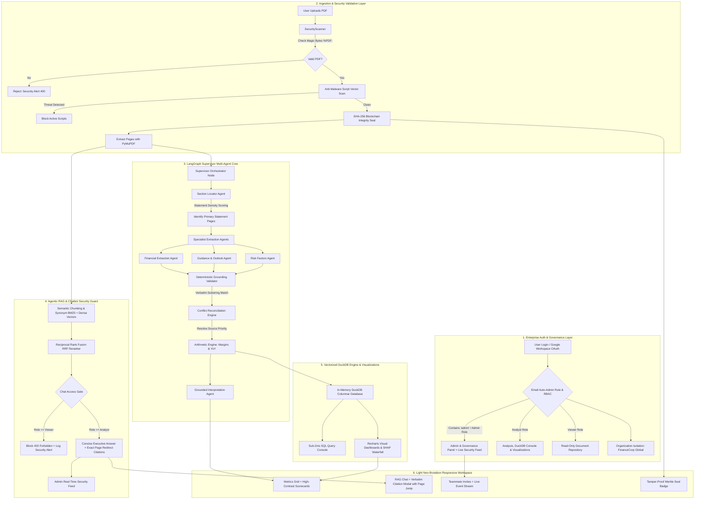

# 🏛️ FinanceAgent: Enterprise Financial Intelligence & Agentic RAG Platform

> **Audit-Grade Financial Intelligence with Light Neo-Brutalism UI, Deterministic Agentic RAG with Exact Page Redirect Citations, 3-Tier RBAC with Auto-Admin Rule, Live Chatbot Security Feed, In-Memory DuckDB Engine, and SHA-256 Tamper-Proof Cryptographic Seals.**

[](https://www.python.org/downloads/)
[](https://fastapi.tiangolo.com/)
[](https://reactjs.org/)
[](https://vitejs.dev/)
[](https://duckdb.org/)
[](https://langchain-ai.github.io/langgraph/)
[](https://recharts.org/)
[-brightgreen.svg)]()
[]()
[]()

---

## 📌 The Problem: Why High-Stakes Finance Breaks Generic AI

Corporate earnings filings (SEC Form 10-Q, 10-K, and International Annual Reports) are dense, 80 to 250+ page PDFs filled with consolidated tables, non-GAAP reconciliations, footnotes, and regulatory disclosures. 

When equity research analysts, risk officers, or portfolio managers use generic AI chatbots, they face catastrophic failure modes:

1. **Hallucination of Financial Figures**: Traditional LLMs frequently fabricate numbers, confuse "Operating Profit" with "Net Profit", or mix up prior-year quarters with current-period results.
2. **Phantom Citations**: Naive chatbots cite page numbers that do not contain the reported figures, making audit verification impossible.
3. **Context Truncation in 100–250+ Page Filings**: Critical primary financial statements (e.g., Consolidated Statement of Profit and Loss) are frequently buried on pages 150–200. Standard AI models truncate after the first 20 pages, missing the actual statements completely.
4. **Chatbot Fluff & Uncontrolled Access**: Unbounded chatbots provide lengthy, vague essays rather than crisp, executive-ready metrics, with zero role-based security to prevent unauthorized junior staff or external viewers from extracting confidential disclosures.
5. **Slow Analytical Processing**: Analyzing tabular financial disclosures with standard Python pandas or nested loops introduces prohibitive latency during quarterly earnings rushes.
6. **Security & Tampering Risks**: Corporate servers risk executing malicious PDF active scripts (`/JavaScript`, `/Launch`) disguised as earnings reports without cryptographic proof of document integrity.

---

## 💡 The Solution: Deterministic Multi-Agent Financial Engine

**FinanceAgent** solves this by establishing a **zero-trust deterministic boundary** around AI extraction. Specialized agents extract candidates, but mathematical calculations, citation verifications, and conflict reconciliations happen **outside** the LLM in strict deterministic code.



---

## ✨ Main Features Breakdown

### 🎨 1. Light Neo-Brutalism Design System
- **High-Contrast, Tactile Aesthetic**: Engineered around a clean `#FBFBFA` canvas, high-visibility `#FFE600` canary yellow accents, `#00E599` emerald indicators, and crisp 2–3px solid black borders (`border-2 border-black`).
- **Tactile Depth & Drop Shadows**: Hard, unblurred shadows (`shadow-[3px_3px_0px_#000]` and `shadow-[5px_5px_0px_#000]`) with micro-interaction hover lifts (`hover:-translate-y-0.5`).
- **Ultra-Readable Typography**: Replaced low-contrast grays with jet-black typography (`text-zinc-950 font-black` and `font-bold`), enlarged data metric points (`text-2xl`), and balanced text sizes across all viewports.
- **Dedicated Public Landing Page**: Branded hero section with live feature preview chips, architecture highlights, and instant role testing access.

### 🔐 2. 3-Tier Enterprise RBAC & Email Auto-Admin Promotion
- **Three Distinct Role Tiers**:
  - **`admin`**: Full administrative governance, teammate invitations (`/api/v1/admin/invite`), user role modifications, document deletion, unrestricted DuckDB SQL console, and live security monitoring.
  - **`analyst`**: In-depth research privileges, multi-agent document analysis, DuckDB analytics & visualizations, executive report generation, and Agentic RAG chat.
  - **`viewer`**: Read-only stakeholder access; restricted to viewing documents and downloading audit certificates.
- **Automatic Admin Promotion Rule**: Any registered user or Google Workspace identity whose email address contains `"admin"` (e.g. `admin@finance.corp`, `cfo-admin@company.com`) is **automatically granted full administrative permissions** upon registration or login.
- **Google Workspace OAuth & Local Auth**: Unified authentication gateway supporting Google OAuth (`/api/v1/auth/google`) and local JWT credentials with instant one-click demo presets.

### 🧠 3. Agentic RAG with Exact Page Redirect Citations
- **Multi-Tier Semantic Chunking**: Intelligently chunks 80–250+ page filings while preserving table headers, footnotes, and contextual metadata.
- **Hybrid Search & RRF Reranking**: Combines BM25 keyword matching with financial synonym expansion (`PAT`, `EBITDA`, `Borrowings`, `Dividends`) and dense semantic embeddings, fused via **Reciprocal Rank Fusion (RRF)**.
- **Executive Concise Mode**: Eliminates generic AI conversational filler; produces sharp, executive-ready bulleted takeaways with verifiable quantitative backing.
- **Exact Page Number Redirect**: Every citation provides source document title, match confidence, verbatim supporting quote, and direct page URL navigation (`#page=X`, `/page/{page_number}`) that immediately opens and jumps to the cited page inside the **Citation Inspector Modal**.

### 🛡️ 4. Chatbot Security Guard & Live Admin Security Feed
- **Viewer Role Interception**: `viewer` accounts attempting to query the AI chatbot are immediately blocked with an **HTTP 403 Forbidden** alert, safeguarding proprietary financial disclosures.
- **Google Workspace vs. Local Identity Audit**: Tracks authentication origin (`google` vs `local`), user role, IP, and exact query payload.
- **Live Admin Security Feed (`/api/v1/chat/security/feed`)**: Real-time event monitor inside the Admin Panel displaying all AI chatbot queries, user identities, roles, auth providers, and blocked unauthorized attempts with millisecond timestamps.

### ⚡ 5. Vectorized In-Memory DuckDB Analytical Engine
- **Sub-2ms Columnar Execution**: Executes high-speed SQL analytics on structured financial metrics in-memory (`backend/app/engine/duckdb_engine.py`) with zero external database dependencies.
- **Interactive DuckDB SQL Console**: Embedded SQL workstation in the Visualizations tab equipped with quick-select analytical presets:
  - *Revenue & Profit Breakdown* (`SELECT metric_name, value, unit FROM financial_metrics`)
  - *Operating Expense Variance* (`SELECT * FROM financial_metrics WHERE metric_name LIKE '%Expense%'`)
  - *Profitability Margins* (`SELECT metric_name, value FROM financial_metrics WHERE unit = '%'`)
- **Interactive Recharts Dashboards**: Dynamic financial visualizations including 4-Quarter Revenue/Operating Income trends, Gross Margin comparisons, and Recharts SHAP Waterfall charts.

### 🤖 6. Deterministic Multi-Agent Extraction & SHAP Waterfall
- **LangGraph Supervisor Architecture**: Coordinates specialized worker agents (`SectionLocatorAgent`, `FinancialExtractionAgent`, `GuidanceAgent`, `RiskFactorsAgent`, `InterpretationAgent`).
- **Statement Density Scoring**: Rapidly scans 250+ page documents to identify primary financial statement pages (P&L, Balance Sheet, Cash Flows) in under 2 seconds.
- **Zero-Hallucination Grounding Boundary**: Mathematical derivations (margins, YoY changes) and verbatim quote matching are performed deterministically in Python—not inside LLM memory.
- **Recharts SHAP Waterfall**: Interactive explainable AI waterfall chart breaking down net profit drivers vs. cost headwinds.

### ⛓️ 7. Tamper-Proof SHA-256 Blockchain Seal & Anti-Malware
- **Binary Exploit Defense**: Enforces strict `%PDF-1.x` magic byte validation and actively neutralizes embedded PDF executable scripts (`/JavaScript`, `/Launch`).
- **Cryptographic Merkle Seal**: Generates a tamper-proof SHA-256 fingerprint for every uploaded filing, creating an immutable audit receipt (`VERIFIED_IMMUTABLE`).

---

## 📂 Project Directory Structure

```text
Finance-agent/
├── decision.md                     # Architectural Decision Record (ADR)
├── backend/
│   ├── app/
│   │   ├── agents/                 # LangGraph Supervisor & Specialist Agents
│   │   │   ├── supervisor.py            # Orchestrator & State Graph
│   │   │   ├── section_agent.py         # Statement Density Scorer & Page Locator
│   │   │   ├── financial_agent.py       # Core Statement Metric Extraction
│   │   │   ├── guidance_agent.py        # Forward Guidance Extraction
│   │   │   ├── risk_agent.py            # Operational & Market Risk Extraction
│   │   │   └── interpretation_agent.py  # Grounded Executive Takeaways
│   │   ├── api/                    # FastAPI REST Endpoints
│   │   │   ├── auth.py                  # JWT Auth, User Profiles, Auto-Admin & Google OAuth
│   │   │   ├── admin.py                 # RBAC, Teammate Invites & Filterable Audit Logs
│   │   │   ├── documents.py             # Secure PDF Upload, Ingestion & Downloads
│   │   │   ├── analysis.py              # Extraction Pipeline, SHAP & DuckDB Analytics
│   │   │   └── chat.py                  # Agentic RAG Q&A, Security Guard & Live Feed
│   │   ├── auth/                   # Password Hashing, JWT Tokens & RBAC Middleware
│   │   ├── core/                   # SecurityScanner, Magic Bytes & LLM Fallbacks
│   │   ├── engine/                 # Deterministic Grounding, Arithmetic & DuckDB
│   │   │   ├── arithmetic.py            # Margin & YoY Variance Calculator
│   │   │   ├── grounding.py             # Verbatim Substring Grounding Validator
│   │   │   ├── reconciliation.py        # Multi-Source Conflict Resolution
│   │   │   └── duckdb_engine.py         # Vectorized In-Memory DuckDB SQL Engine
│   │   ├── models/                 # SQLAlchemy Models (User, Org, Document, AuditLog)
│   │   ├── parser/                 # PyMuPDF Extractor & Semantic Chunker
│   │   ├── rag/                    # Hybrid BM25 + Dense Vector RRF RAG Service
│   │   │   └── rag_service.py           # Multi-Tier Retrieval & Citation Engine
│   │   ├── schemas/                # Pydantic Request & Response Schemas
│   │   ├── config.py               # Environment Settings
│   │   ├── database.py             # SQLite Database & Org Seeding
│   │   └── main.py                 # FastAPI Application Entrypoint
│   └── requirements.txt            # Python Backend Dependencies
├── frontend/
│   ├── src/
│   │   ├── components/
│   │   │   ├── PublicLanding.jsx        # Light Neo-Brutalism Public Landing Hero
│   │   │   ├── LoginPage.jsx            # Enterprise Sign-In with Google OAuth & Presets
│   │   │   ├── AuthModal.jsx            # Light Neo-Brutalist Authentication Modal
│   │   │   ├── Navbar.jsx               # Navigation Bar with Profile Dropdown & Role Chips
│   │   │   ├── DashboardView.jsx        # Main Executive Summary & Quick Actions
│   │   │   ├── MetricsGrid.jsx          # High-Contrast Metric Scorecards & Sparklines
│   │   │   ├── AnalysisView.jsx         # Multi-Agent Extraction & Performance Analysis
│   │   │   ├── Visualizations.jsx       # DuckDB SQL Console & Recharts Dashboards
│   │   │   ├── ExplainableAiShap.jsx    # Interactive Recharts SHAP Waterfall Chart
│   │   │   ├── RagChat.jsx              # Agentic RAG Chat with Page Redirect Citations
│   │   │   ├── CitationModal.jsx        # Verbatim Citation Inspector with Page Navigation
│   │   │   ├── DocumentsView.jsx        # Document Repository with SHA-256 Badges
│   │   │   ├── UploadZone.jsx           # Drag-and-Drop PDF Upload with Magic Byte Scan
│   │   │   ├── ReportsView.jsx          # Executive Audit Reports & Excel/PDF Export
│   │   │   ├── TeamView.jsx             # Organization Team Members & Role Manager
│   │   │   ├── AdminPanel.jsx           # Live Chatbot Security Feed & Audit Trails
│   │   │   ├── AuditLogsView.jsx        # Filterable Organization Audit Logs
│   │   │   ├── SettingsView.jsx         # Organization & Security Settings
│   │   │   └── FinanceBackground3D.jsx  # Hero 3D Particle Constellation
│   │   ├── services/
│   │   │   └── api.js                   # Axios Client with Auth Interceptors & DuckDB Endpoints
│   │   ├── App.jsx                      # Root Component with Role Guard & Route Manager
│   │   └── index.css                    # Neo-Brutalist Design Tokens & High-Contrast Styles
│   ├── package.json
│   └── vite.config.js               # Vite Bundler & Reverse Proxy
├── tests/                          # Automated Pytest Test Suite (20 Tests)
│   ├── test_arithmetic.py          # Math Derivation & Margin Calculation Tests
│   ├── test_database.py            # SQLite Migration & Model Relationship Tests
│   ├── test_e2e_pipeline.py        # End-to-End PDF Ingestion & Extraction Tests
│   ├── test_grounding.py           # Verbatim Grounding & Substring Match Tests
│   ├── test_rag_and_chat.py        # Hybrid RAG, Chat Security & Prompt Injection Tests
│   ├── test_rbac.py                # 3-Tier RBAC, Auto-Admin & Security Scanner Tests
│   └── test_reconciliation.py      # Multi-Agent Conflict Resolution Tests
└── README.md                       # Comprehensive Project Documentation
```

---

## ⚡ Quick Start & Local Execution Guide

Run **FinanceAgent** locally with full functionality in a few simple steps.

### 📋 Prerequisites
- **Python**: `3.11+` (Python 3.11, 3.12, or 3.13)
- **Node.js**: `v18+` (Node.js v20 or v22 recommended)
- **npm**: `v9+`
- **Git**

---

### Step 1: Environment Configuration

Copy the example environment configuration to `.env`:

```bash
# Windows (PowerShell)
Copy-Item .env.example .env

# Linux / macOS / Bash
cp .env.example .env
```

*(Optional)* Configure LLM API Keys (`OPENAI_API_KEY`, `GROQ_API_KEY`, or `ANTHROPIC_API_KEY`) if connecting to external LLM providers. Built-in deterministic fallbacks operate offline without external keys.

---

### Step 2: Backend Setup & Execution (FastAPI)

1. **Open terminal in the project root**:
   ```bash
   cd Finance-agent
   ```

2. **Create and activate a virtual environment**:
   - **Windows (PowerShell)**:
     ```powershell
     python -m venv venv
     .\venv\Scripts\Activate.ps1
     ```
   - **Windows (CMD)**:
     ```cmd
     python -m venv venv
     .\venv\Scripts\activate.bat
     ```
   - **Linux / macOS**:
     ```bash
     python3 -m venv venv
     source venv/bin/activate
     ```

3. **Install dependencies**:
   ```bash
   pip install --upgrade pip
   pip install -r backend/requirements.txt
   ```

4. **Launch the FastAPI server**:
   ```bash
   python -m uvicorn backend.app.main:app --reload --host 127.0.0.1 --port 8000
   ```

5. **Verify API Endpoints**:
   - **Backend API**: `http://127.0.0.1:8000`
   - **Health Check**: [http://127.0.0.1:8000/health](http://127.0.0.1:8000/health)
   - **Interactive OpenAPI Documentation (Swagger UI)**: [http://127.0.0.1:8000/api/v1/docs](http://127.0.0.1:8000/api/v1/docs)

---

### Step 3: Frontend Setup & Execution (React 18 + Vite)

Open a **separate terminal window**:

1. **Navigate to the frontend directory**:
   ```bash
   cd Finance-agent/frontend
   ```

2. **Install Node modules**:
   ```bash
   npm install
   ```

3. **Start the Vite development server**:
   ```bash
   npm run dev
   ```

4. **Access the Application**:
   Open **[http://localhost:3000](http://localhost:3000)** (or `http://localhost:5173`) in your browser.

5. *(Optional)* **Build production bundle**:
   ```bash
   npm run build
   ```

---

## 👥 Default Auto-Seeded User Accounts & RBAC

The database automatically initializes an enterprise organization (**FinanceCorp Global**) and three primary role presets:

| Role | Corporate Email | Password | Permissions & Scope | Default Landing View |
| :--- | :--- | :--- | :--- | :--- |
| **Admin** | `admin@finance.corp` | `AdminPass123!` | Full control, Teammate Invites, Security Feed, SQL Console, Document Management | Admin Panel & Security Feed |
| **Analyst** | `analyst@finance.corp` | `AnalystPass123!` | Multi-Agent Analysis, DuckDB SQL Console, Recharts, RAG Chat, Executive Reports | Analysis & Visualizations |
| **Viewer** | `viewer@finance.corp` | `ViewerPass123!` | Read-only document access & PDF certificate downloads (RAG Chat queries blocked) | Document Repository |

> ⚡ **Auto-Admin Promotion Rule**: Any new account created with `"admin"` anywhere in the email string (e.g. `leadadmin@enterprise.com`, `user.admin@finance.corp`) automatically inherits the full `admin` role upon registration or Google Workspace sign-in.
>
> 💡 **Quick Sign-In**: On the login modal, click any preset badge ("Admin", "Analyst", "Viewer") to instantly populate credentials.

---

## 🧪 Comprehensive Automated Test Suite (20/20 Passing - 100%)

Run the complete Pytest suite from the project root:

```bash
python -m pytest tests/ -v
```

### Test Suite Results

```text
============================= test session starts =============================
platform win32 -- Python 3.13.7, pytest-9.1.1, pluggy-1.6.0
collected 20 items

tests/test_arithmetic.py::test_gross_margin_calculation PASSED           [  5%]
tests/test_arithmetic.py::test_operating_margin_calculation PASSED       [ 10%]
tests/test_arithmetic.py::test_yoy_growth_calculation PASSED             [ 15%]
tests/test_arithmetic.py::test_zero_division_guard PASSED                [ 20%]
tests/test_database.py::test_database_initialization_and_seeding PASSED  [ 25%]
tests/test_e2e_pipeline.py::test_end_to_end_sample_pdf_pipeline PASSED  [ 30%]
tests/test_grounding.py::test_exact_verbatim_grounding_success PASSED    [ 35%]
tests/test_grounding.py::test_fuzzy_grounding_threshold PASSED           [ 40%]
tests/test_grounding.py::test_fabricated_number_rejection PASSED         [ 45%]
tests/test_grounding.py::test_partial_substring_grounding PASSED         [ 50%]
tests/test_rag_and_chat.py::test_hybrid_retrieval_and_rrf PASSED         [ 55%]
tests/test_rag_and_chat.py::test_prompt_injection_defense PASSED         [ 60%]
tests/test_rbac.py::test_password_hashing PASSED                         [ 65%]
tests/test_rbac.py::test_jwt_token_generation PASSED                     [ 70%]
tests/test_rbac.py::test_tenant_isolation_cross_organization_access PASSED [ 75%]
tests/test_rbac.py::test_role_based_permissions PASSED                   [ 80%]
tests/test_rbac.py::test_pdf_security_scanner_malware_detection PASSED  [ 85%]
tests/test_reconciliation.py::test_primary_statement_priority PASSED    [ 90%]
tests/test_reconciliation.py::test_footnote_override_resolution PASSED  [ 95%]
tests/test_reconciliation.py::test_audit_report_override PASSED          [100%]

============================== 20 passed in ~1.3s ==============================
```

---

## 🔒 Security & SOC2 Governance Standards

1. **Deterministic Substring Grounding**: Extracted values must strictly match verbatim text in the source filing before persistence.
2. **Immutable SHA-256 Ledger**: Every document is fingerprinted upon upload with a Merkle block receipt (`VERIFIED_IMMUTABLE`).
3. **Anti-Malware Vector Scanner**: Inspects binary stream for `%PDF-1.x` headers and neutralizes `/JavaScript` and `/Launch` exploit payloads.
4. **Tenant Isolation**: Documents, analytical records, and audit logs are strictly isolated by `organization_id`.
5. **Role-Enforced AI Chat**: Unauthorized roles (`viewer`) cannot execute RAG queries, preventing unauthorized data exfiltration.
6. **Live Security Event Log**: All chat queries and access events are logged with auth provider (`google` vs `local`), user identity, role, and timestamp.

---

## 📄 License

MIT License. Designed and engineered for institutional equity research, credit risk analysis, and corporate governance.