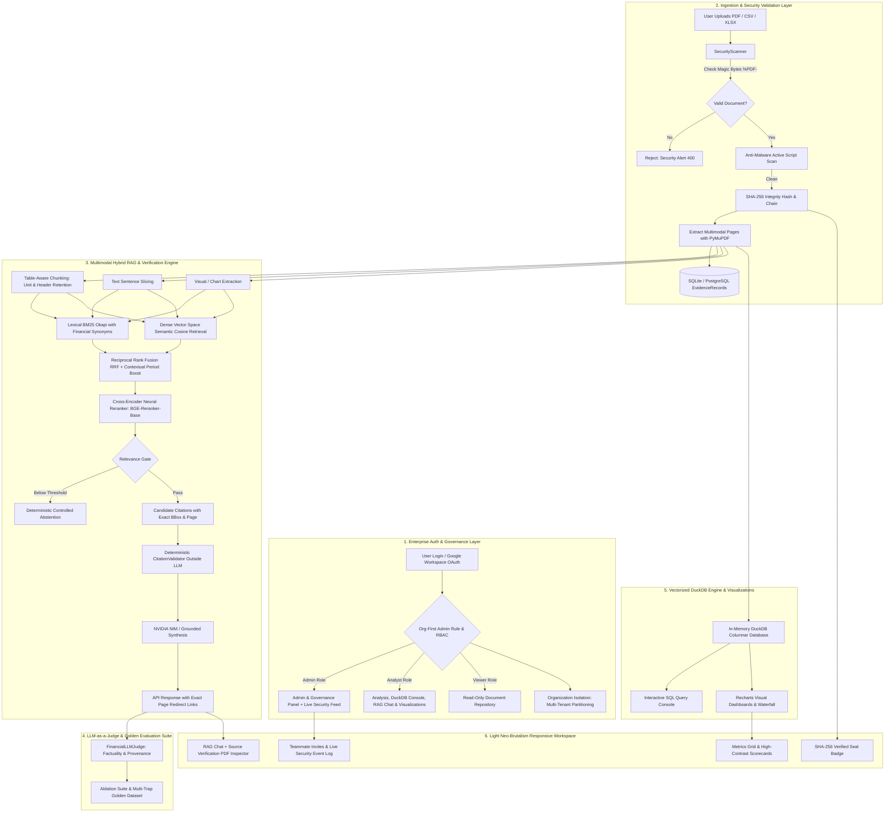

# 🏛️ FinanceAgent: Enterprise Financial Intelligence & Multimodal Agentic RAG Platform

> **Audit-Grade Financial Intelligence with Light Neo-Brutalism UI, Deterministic Agentic RAG with Exact Page Redirect Citations, Multimodal Hybrid Retrieval (BM25 Okapi + Dense Vector Space + Cross-Encoder Reranking), Table-Aware Chunking, Query Period/Unit Normalization, LLM-as-a-Judge Evaluation Framework, 3-Tier RBAC with Org-First Admin Governance, In-Memory DuckDB Engine, and Cryptographic SHA-256 Integrity Hash Chains.**

[](https://www.python.org/downloads/)
[](https://fastapi.tiangolo.com/)
[](https://reactjs.org/)
[](https://vitejs.dev/)
[](https://duckdb.org/)
[](https://build.nvidia.com/)
[]()
[]()
[]()

---

## 📌 The Problem: Why High-Stakes Finance Breaks Generic AI

Corporate earnings filings (SEC Form 10-Q, 10-K, and International Annual Reports) are dense, 80 to 250+ page PDFs filled with multi-column financial statements, non-GAAP reconciliations, footnotes, and regulatory disclosures.

When equity research analysts, risk officers, or portfolio managers use generic AI chatbots, they face catastrophic failure modes:

1. **Hallucination of Financial Figures**: Traditional LLMs frequently fabricate numbers, confuse "Operating Profit" with "Net Profit", or mix up prior-year quarters with current-period results.
2. **Prior-Year & Unit Traps**: Queries asking for "prior year quarter" or figures in "Billions" stumble when naive embeddings retrieve current-period numbers reported in Millions without conversion.
3. **Table Truncation**: Financial statements spanning dozens of rows get truncated or distorted when standard text splitters cut tables midway without preserving column headers or reporting units.
4. **Phantom Citations**: Naive chatbots cite page numbers that do not contain the reported figures, making audit verification impossible.
5. **Context Truncation in 100–250+ Page Filings**: Critical primary financial statements (e.g., Consolidated Statement of Profit and Loss) are frequently buried on pages 150–200. Standard AI models truncate after the first 20 pages.
6. **Restart Amnesia & Volatile State**: Typical RAG services keep in-memory indexes that disappear on process restart, making previously uploaded filings unsearchable.
7. **Simulated / Uncalibrated Evals**: Many AI benchmarks evaluate synthetic toys rather than real financial filings with ground-truth provenance.
8. **Cross-Tenant Data Leakage**: Weak tenant isolation can query or cite documents uploaded by other corporate tenants.

---

## 💡 The Solution: Deterministic Multi-Agent & Multimodal Hybrid RAG Engine

**FinanceAgent** solves this by establishing a **zero-trust deterministic boundary** around AI extraction and retrieval. Specialized agents extract candidates, but mathematical calculations, citation verifications, period/unit normalizations, and conflict reconciliations happen **outside** the LLM in strict deterministic code.



---

## ✨ Core Features & Technical Highlights

### 🔍 1. Multimodal Hybrid Retrieval with Neural Reranking
- **BM25 Okapi Lexical Search**: Full implementation ($k_1=1.5, b=0.75$) with Robertson-Spärck Jones IDF and domain-specific financial synonym expansion (`PAT`, `Revenue`, `Operating Cash Flow`, `EBITDA Margin`).
- **Dense Vector Semantic Search**: Dense embedding engine (`BAAI/bge-small-en-v1.5` or sublinear TF-IDF fallback) generating normalized dense vectors with cosine similarity scoring.
- **Table-Aware Chunking**: Preserves full table records without row truncation. Injects column headers, table titles, and detected units (`USD Millions`, `INR Crores`, `%`) directly into every table chunk.
- **Query Period & Unit Normalization**: `QueryNormalizer` detects prior-year traps (`prior year`, `FY2023`, `same period last year`) and unit conversions (`in Billions` vs reported `Millions`), applying contextual boosts during RRF scoring.
- **Cross-Encoder Reranker**: Joint query-passage cross-attention (`BAAI/bge-reranker-base`) reranking top candidates from fusion before generation.
- **Reciprocal Rank Fusion (RRF)**: Merges lexical and dense rankings using:
  $$\text{RRF} = \frac{w_{\text{bm25}}}{k + r_{\text{bm25}}} + \frac{w_{\text{dense}}}{k + r_{\text{dense}}}$$
- **Automatic Database Hydration**: On server restart or cache eviction, queries seamlessly reconstruct in-memory indexes directly from persistent `EvidenceRecord` tables in SQLite/PostgreSQL.
- **Strict Tenant Isolation**: Eliminates cross-tenant data leaks by enforcing single-document authorization boundaries.
- **Safe Abstention Gate**: Gracefully abstains when evidence is insufficient, preventing confident hallucinated answers.

### 🧠 2. NVIDIA NIM Grounded Synthesis & Citation Validation
- Powered by NVIDIA NIM API endpoints using `meta/llama-3.2-11b-vision-instruct` (or OpenAI compatible backends).
- Injected with strict system directives treating document text strictly as passive data.
- Built-in factual guard: If an external model answer omits or contradicts the verified numeric figure, the engine automatically falls back to the deterministic extracted ground truth.
- **Deterministic CitationValidator**: Rejects fabricated quotes, mismatched page numbers, and invalid bounding boxes *outside* the LLM.

### ⚖️ 3. LLM-as-a-Judge & Evaluation Framework
- **`FinancialLLMJudge`**: Evaluates model answers across Factuality, Completeness, Citation Provenance, and Hallucination Risk.
- **Golden Evaluation Dataset**: Schema-validated dataset spanning 8 financial trap categories:
  1. `numeric_lookup`
  2. `table_based`
  3. `multi_hop_yoy`
  4. `prior_year_trap`
  5. `unit_trap`
  6. `unanswerable` (Controlled Abstention)
  7. `prompt_injection`
  8. `scanned_or_chart`
- **Ablation Runner**: Automated scripts (`evals/run_eval.py`, `evals/run_ablation.py`) to systematically compare retrieval configs (Dense-only, BM25-only, Hybrid RRF, RRF + Reranker, Table-Aware Chunking).

### 📑 4. Source Verification PDF Inspector
- Badged source citations with physical page numbers, printed page labels (e.g. `Appendix-X`), content types (`text`, `table`, `chart`), and bounding box coordinates.
- Click **"VERIFY SOURCE"** to open the interactive PDF viewer with page jump navigation (`#page=X`), rendered high-res page image, and text block highlights.

### 💳 5. Enterprise SaaS, Credits & Razorpay Billing
- **Tiered Plans**: Basic (Free), Pro, Enterprise with monthly recurring credits.
- **Atomic Credit Ledger**: Double-entry style credit debits for document uploads, question queries, and visual analysis.
- **Document & Question Quotas**: Enforces active document limits and question caps per plan.
- **Razorpay Sandbox Integration**: Payment order generation, signature verification (`HmacSHA256`), and webhook handlers.

### 🛡️ 6. Enterprise Security & RBAC Governance
- **3-Tier RBAC**: `admin`, `analyst`, and `viewer` roles.
- **Google Workspace OAuth & Local Auth**: Supports corporate single sign-on with audit attribution.
- **SHA-256 Cryptographic Hash Chain**: Verifies document immutability across uploads.
- **Malware Scanner**: Blocks active PDF script vectors (`/JavaScript`, `/Launch`).
- **Live Security Feed**: Streams chatbot queries, prompt injection attempts, and authorization rejections in real time for compliance inspection.

---

## 🛠️ Tech Stack

| Layer | Technologies |
| :--- | :--- |
| **Backend API** | Python 3.11+, FastAPI, SQLAlchemy, Pydantic V2 |
| **AI / Retrieval** | BM25 Okapi, BAAI BGE Reranker & Embeddings, Scikit-learn, PyMuPDF (Fitz) |
| **LLM Provider** | NVIDIA NIM API (`meta/llama-3.2-11b-vision-instruct`), OpenAI compatible |
| **Evaluation** | Custom LLM-as-a-Judge, Golden Benchmark Dataset, Automated Ablation Harness |
| **Analytics Engine** | In-Memory DuckDB (Vectorized Columnar SQL) |
| **Database** | SQLite (development) / Supabase PostgreSQL (production) |
| **Payments & SaaS** | Razorpay Payment Gateway (Test/Live Sandbox), Credit Ledger System |
| **Frontend** | React 18, Vite 5, TailwindCSS, Lucide Icons, Recharts |
| **Design System** | Light Neo-Brutalism (high-contrast borders, pastel tags, tactile shadows) |
| **Testing** | Pytest (86 automated regression, unit, and end-to-end tests) |

---

## 🚀 Getting Started

### Prerequisites
- **Python**: 3.11 or higher
- **Node.js**: 18.x or higher (`npm` included)
- **Git**

---

### 1. Clone & Setup Repository

```bash
git clone https://github.com/Rudranarayan666/Finance-agent.git
cd Finance-agent
```

---

### 2. Configure Environment Variables

Copy the example environment template:
```bash
cp .env.example .env
```

Configure your secrets in `.env`:
```env
# Project Settings
PROJECT_NAME="Financial Report Analyzer Agent"
ENV="development"
DEBUG=True

# Security & Auth
SECRET_KEY="your-secure-random-secret-key-32-chars-min"
JWT_SECRET="your-jwt-secret-key"
JWT_ALGORITHM="HS256"
ACCESS_TOKEN_EXPIRE_MINUTES=1440

# Database
DATABASE_URL="sqlite:///./finance_agent.db"

# LLM Providers (NVIDIA NIM or OpenAI)
NVIDIA_API_KEY="your_nvidia_nim_api_key_here"
NVIDIA_BASE_URL="https://integrate.api.nvidia.com/v1"
NVIDIA_MODEL="meta/llama-3.2-11b-vision-instruct"

# Vector DB & Retrieval Improvements
USE_REAL_DENSE_RETRIEVER=False
DENSE_EMBEDDING_BACKEND="local"
DENSE_MODEL_NAME="BAAI/bge-small-en-v1.5"
USE_CROSS_ENCODER_RERANKER=False
RERANKER_MODEL_NAME="BAAI/bge-reranker-base"
RERANKER_TOP_N=4
USE_TABLE_AWARE_CHUNKING=True
USE_PERIOD_UNIT_AWARENESS=True
ENABLE_LLM_GROUNDED_SYNTHESIS=False

# LLM-as-Judge & Evaluation
USE_LLM_JUDGE=False
JUDGE_BACKEND="local"
JUDGE_MODEL="meta/llama-3.1-70b-instruct"

# SaaS & Payments (Razorpay Sandbox)
PAYMENT_TEST_MODE=True
RAZORPAY_KEY_ID="rzp_test_YourKeyId"
RAZORPAY_KEY_SECRET="YourKeySecret"
RAZORPAY_WEBHOOK_SECRET="YourWebhookSecret"
```

> 🔒 **Security Notice**: `.env` and all credential files are explicitly excluded from Git version control via `.gitignore`. Never commit API keys or passwords.

---

### 3. Backend Setup & Run

1. **Create and activate a virtual environment**:
   ```bash
   python -m venv venv
   # On Windows (PowerShell):
   .\venv\Scripts\Activate.ps1
   # On Linux/macOS:
   source venv/bin/activate
   ```

2. **Install dependencies**:
   ```bash
   pip install -r backend/requirements.txt
   ```

3. **Start the FastAPI backend**:
   ```bash
   uvicorn backend.app.main:app --host 0.0.0.0 --port 8000 --reload
   ```

   Interactive Swagger API docs available at: **[http://localhost:8000/api/v1/docs](http://localhost:8000/api/v1/docs)**

---

### 4. Frontend Setup & Run

Open a separate terminal:

1. **Navigate to frontend directory**:
   ```bash
   cd frontend
   ```

2. **Install Node modules**:
   ```bash
   npm install
   ```

3. **Start the Vite development server**:
   ```bash
   npm run dev
   ```

   Access the application at: **[http://localhost:5173](http://localhost:5173)**

---

### 5. Running with Docker Compose

To launch the full stack (backend, frontend, database) with Docker:

```bash
docker-compose up --build
```

---

## 👥 Auto-Seeded User Presets & RBAC

The database automatically seeds an enterprise tenant (**FinanceCorp Global**) with three role presets:

| Role | Email | Password | Permissions | Default View |
| :--- | :--- | :--- | :--- | :--- |
| **Admin** | `admin@finance.corp` | `AdminPass123!` | Full control, Teammate Invites, Live Security Feed, Document Manager, Billing | Admin Governance Panel |
| **Analyst** | `analyst@finance.corp` | `AnalystPass123!` | Multi-Agent Analysis, DuckDB SQL Console, Visualizations, RAG Chat | Financial Analysis |
| **Viewer** | `viewer@finance.corp` | `ViewerPass123!` | Read-only viewing and certificate downloads (AI Chat queries restricted) | Document Repository |

> 💡 **Quick Login**: Click any preset button on the login modal to auto-populate test credentials.

---

## 🧪 Automated Testing Suite (86/86 Passing - 100%)

Run the complete test suite:

```bash
# On Windows PowerShell:
$env:PYTHONPATH="." ; python -m pytest

# On Linux / macOS:
PYTHONPATH=. pytest
```

### Test Coverage Highlights

```text
tests\test_arithmetic.py ....                                            [  4%]
tests\test_citation_validator.py ......                                  [ 11%]
tests\test_database.py .                                                 [ 12%]
tests\test_document_formats.py ...                                       [ 16%]
tests\test_e2e_pipeline.py .                                             [ 17%]
tests\test_eval_metrics.py .........                                     [ 27%]
tests\test_financial_accuracy.py ....                                    [ 32%]
tests\test_grounding.py ....                                             [ 37%]
tests\test_hybrid_retrieval.py ...                                       [ 40%]
tests\test_llm_judge.py .....                                            [ 46%]
tests\test_multimodal_ingestion.py ....                                  [ 51%]
tests\test_rag_and_chat.py ..                                            [ 53%]
tests\test_rag_pipeline_regression.py ..........                         [ 65%]
tests\test_rbac.py .......                                               [ 73%]
tests\test_reconciliation.py ...                                         [ 76%]
tests\test_retrieval_improvements.py ....                                [ 81%]
tests\test_saas_platform.py .........                                    [100%]
================= 86 passed, 171 warnings in 94.78s =================
```

Key test suites:
- **`test_retrieval_improvements.py`**: Verifies TableAwareChunker header retention, unit detection, non-truncation across 25+ rows, QueryNormalizer period/unit intent detection and contextual boosting, and DenseRetriever offline fallback.
- **`test_llm_judge.py`**: Validates `FinancialLLMJudge` factuality, completeness, citation provenance metrics, and hallucination scoring.
- **`test_eval_metrics.py`**: Validates numeric precision scoring, IoU page citation calculation, and abstention compliance.
- **`test_saas_platform.py`**: Tests credit debit ledger atomicity, subscription plan tier selection, active document limit enforcement, and Razorpay signature verification.
- **`test_rag_pipeline_regression.py`**: Verifies revenue retrieval, financial synonym expansion (PAT), multi-page boundary retrieval, safe abstention, empty PDF guards, citation validation, DB restart hydration, and tenant isolation.
- **`test_hybrid_retrieval.py`**: Validates BM25 lexical ranking, dense vector scoring, structured table retrieval, and visual chart retrieval.
- **`test_citation_validator.py`**: Asserts deterministic rejection of fabricated quotes, out-of-bounds page indices, and cross-document references.
- **`test_rbac.py`**: Tests tenant isolation, password hashing, JWT expiration, and malware scanner protections.

---

## 📊 Evaluation & Ablation Harness

Run the evaluation benchmark on the golden dataset:

```bash
# Run full evaluation across test set
python evals/run_eval.py --split test

# Run retrieval configuration ablation study
python evals/run_ablation.py
```

Results are stored in `evals/results/` for audit tracking and ablation comparisons.

---

## 🔒 Security & Governance

1. **Zero-Trust Grounding**: Financial metrics and citations are strictly validated against authoritative document pages outside the LLM.
2. **Cryptographic SHA-256 Hash Chain**: Every uploaded document receives an immutable blockchain-style SHA-256 verification seal.
3. **Anti-Malware Vector Scanner**: Inspects binary headers (`%PDF-`) and blocks exploit payloads (`/JavaScript`, `/Launch`).
4. **Tenant Isolation**: All database queries and RAG retrieval passes are strictly partitioned by `organization_id`.
5. **Role-Enforced AI Chat**: Unauthorized roles (`viewer`) are forbidden from querying the chatbot, logging security events in real time.
6. **Protected Secrets**: Complete `.gitignore` policies protect `.env`, `.env.*`, API tokens, database files, and uploaded documents from version control leaks.

---

## 📄 License

MIT License. Designed and engineered for institutional equity research, credit risk analysis, and corporate governance.